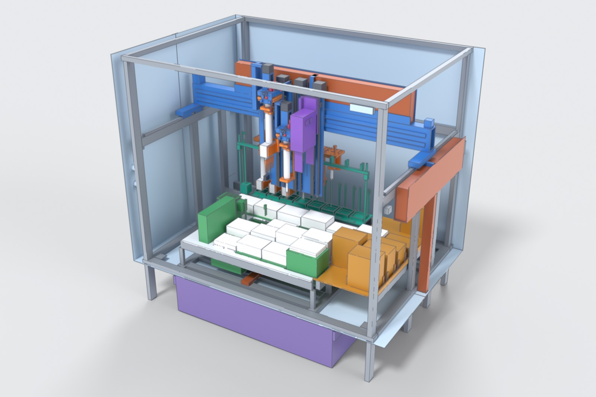
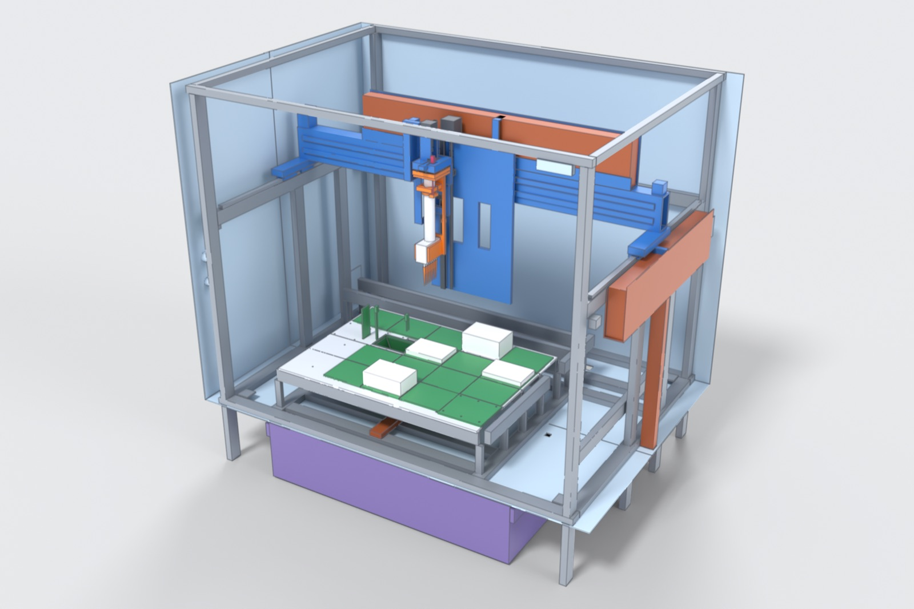
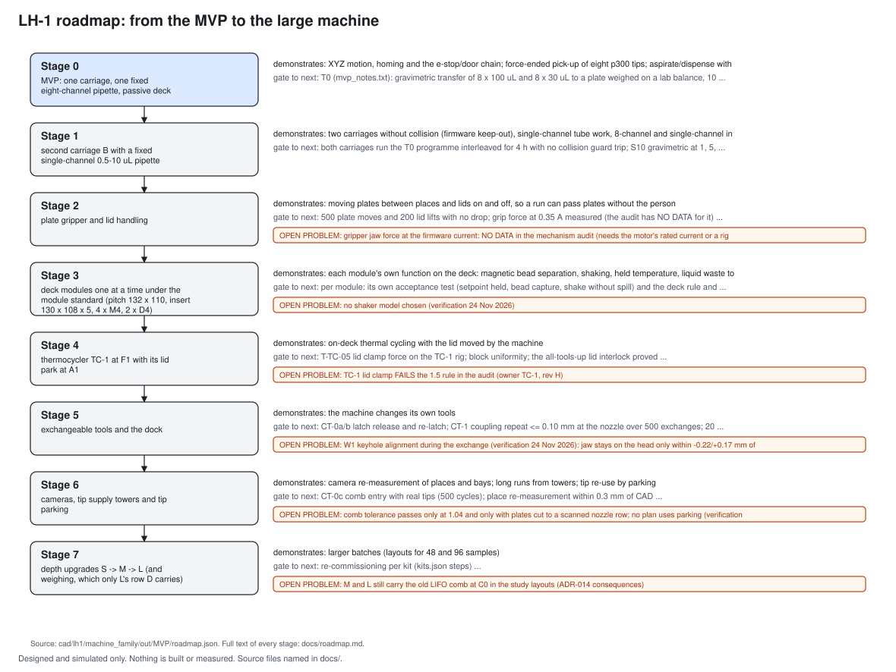

# LH-1: an open liquid-handling robot you build yourself

LH-1 is a gantry liquid handler designed to be built by a careful amateur from bought parts, laser-cut sheet and a few machined parts. It moves bought hand pipettes in machined cradles over a deck of standard plate-sized places. It is designed as one machine in three depths (S, M and L) and starts from a small first build, the MVP.



*The starter (size S) as modelled in CAD. Door, roof and right panel hidden. Rendered from the model; nothing is built.*

> **Status: designed and simulated only.** Nothing has been built, bought or measured. Every figure here comes from the CAD, the electrical design or a calculation in this repository. Two open problems in the tool latch and coupling block the automatic tool exchange (see [open problems](docs/open-problems.md)). There is no safety assessment.

## Start here: the MVP

> **An even smaller first step:** the [bench rig](docs/bench-rig.md) is one axis and one pipette on a bench. It is designed to measure the plunger, tip pick-up and tip strip forces before anything for the machine is bought. Build it first if you want numbers before committing to the frame.

The MVP is stage 0 of the starter. It is the starter's own frame, gantry, deck, drawer, enclosure and control compartment with **one tool carriage** and **one eight-channel 30-300 uL pipette** over a passive deck. The tool is held by a manual clamp, so there is no tool dock and no automatic exchange yet. Size 1,344 x 894 x 1,190 mm (W x D x H), about 114 kg (estimate). Parts: 143 made and 65 bought ([parts_MVP.csv](cad/lh1/machine_family/out/MVP/parts_MVP.csv)).



*The MVP as modelled. One carriage, the eight-channel tool, tips at G3, a reservoir at F2, two plates and the tip waste.*

**What it is designed to demonstrate:** XYZ motion, homing and the e-stop/door chain; force-ended pick-up of eight p300 tips; aspirate/dispense with the pusher; reservoir-to-plate and plate-to-plate transfers; a serial dilution across a plate; eject at the tip waste; repeated cycles.

**What to buy and make first:** the frame extrusions cut to length, rails and blocks, motors and belts, the plunger pusher, the coupling parts (tooling balls, vee seats, retention knob), switches, the bought eight-channel pipette, the safety relays, supplies and controller boards; then the laser-cut deck strips and panels and the machined carriage and cradle parts. The full lists and the assembly order are in **[docs/mvp.md](docs/mvp.md)**.

Files: [CAD outputs](cad/lh1/machine_family/out/MVP/), [MVP electrics](electronics/lh1/out/mvp/), [firmware profile](firmware/lh1/lh1_profile_MVP.cfg), [deck map](docs/img/deck_map_MVP.svg).

## Roadmap: from the MVP to the large machine



| Stage | Adds | Demonstrates | Test that gates the next stage | Open before it can proceed |
|---|---|---|---|---|
| 0 | MVP: one carriage, one fixed eight-channel pipette, passive deck | XYZ motion, homing and the e-stop/door chain; force-ended pick-up of eight p300 tips; aspirate/dispense with the pusher; reservoir-to-plate and plate-to-plate transfers; a serial dilution across a plate; eject at the tip waste; repeated cycles | T0 (mvp_notes.txt): gravimetric transfer of 8 x 100 uL and 8 x 30 uL to a plate weighed on a lab balance, 10 repeats: per-channel mean within 2 % and CV within 1.5 % at 100 uL (ISO 8655 class targets, ASSUMED for this machine); a 1:2 serial dilution of dye over 11 columns read by absorbance, slope within 5 % of the ideal; 200 pick-up/eject cycles with no missed or retained tip; 20 re-clamps of the tool with nozzle position repeat <= 0.10 mm | none recorded |
| 1 | second carriage B with a fixed single-channel 0.5-10 uL pipette | two carriages without collision (firmware keep-out), single-channel tube work, 8-channel and single-channel in one run | both carriages run the T0 programme interleaved for 4 h with no collision guard trip; S10 gravimetric at 1, 5, 10 uL | none recorded |
| 2 | plate gripper and lid handling | moving plates between places and lids on and off, so a run can pass plates without the person | 500 plate moves and 200 lid lifts with no drop; grip force at 0.35 A measured (the audit has NO DATA for it) | gripper jaw force at the firmware current: NO DATA in the mechanism audit (needs the motor's rated current or a rig measurement) |
| 3 | deck modules one at a time under the module standard (pitch 132 x 110, insert 130 x 108 x 5, 4 x M4, 2 x D4) | each module's own function on the deck: magnetic bead separation, shaking, held temperature, liquid waste to canisters | per module: its own acceptance test (setpoint held, bead capture, shake without spill) and the deck rule and interference checks re-run with that module in the layout | no shaker model chosen (verification 24 Nov 2026) |
| 4 | thermocycler TC-1 at F1 with its lid park at A1 | on-deck thermal cycling with the lid moved by the machine | T-TC-05 lid clamp force on the TC-1 rig; block uniformity; the all-tools-up lid interlock proved | TC-1 lid clamp FAILS the 1.5 rule in the audit (owner TC-1, rev H) |
| 5 | exchangeable tools and the dock | the machine changes its own tools | CT-0a/b latch release and re-latch; CT-1 coupling repeat <= 0.10 mm at the nozzle over 500 exchanges; 20 exchanges per carriage per bay | W1 keyhole alignment during the exchange (verification 24 Nov 2026): jaw stays on the head only within -0.22/+0.17 mm of bar height; W2 one-sided 45 deg wedge preload pushes the tool sideways about as hard as the preload; no calculation covers it; major: re-latch margin 1.5 only at nominal (1.39-1.49 in its band, 1.04 in CT-0b); constant-force springs at about 4 GPa; the redesign must be rig-tested before any machine purchase (ADR-014) |
| 6 | cameras, tip supply towers and tip parking | camera re-measurement of places and bays; long runs from towers; tip re-use by parking | CT-0c comb entry with real tips (500 cycles); place re-measurement within 0.3 mm of CAD | comb tolerance passes only at 1.04 and only with plates cut to a scanned nozzle row; no plan uses parking (verification 24 Nov 2026) |
| 7 | depth upgrades S -> M -> L (and weighing, which only L's row D carries) | larger batches (layouts for 48 and 96 samples) | re-commissioning per kit (kits.json steps) | M and L still carry the old LIFO comb at C0 in the study layouts (ADR-014 consequences) |


stages 1-4 and 6 are independent of the latch; stage 5 is held until W1 and W2 are solved on paper and rig-tested. Each stage has a page in [docs/build/](docs/build/). Source: [roadmap.json](cad/lh1/machine_family/out/MVP/roadmap.json).

## What the full machine is designed to do

The starter S is 1,456 x 894 x 1,190 mm with its extraction fan and about 150 kg (estimate). M and L add one and two rows of deck places in depth: M 1,456 x 1,004 x 1,190 mm, L 1,456 x 1,114 x 1,190 mm. In summary, as designed:

- two tool carriages, each able to take any tool from an eight-bay passive dock (about 92.3 s per exchange, calculated);
- tools: eight-channel 0.5-10, 5-50 and 30-300 uL; single-channel 0.5-10, 10-100 and 100-1,000 uL; a 10 mL syringe dispense tool;
- a plate gripper on its own Z axis for plates and lids;
- deck places on a 132 x 110 mm grid, each taking a standard insert, so modules can be swapped: on-deck thermocycler, heated and cooled blocks, magnet block, heater-shaker, liquid waste, tip parking;
- tip supply from shelf towers refilled into deck frames by the gripper; tip waste to a crate in a drawer;
- checks that can only hold a run: a through-beam tip gate, a tip-check camera, a head camera reading deck markers;
- a full enclosure with a coded door sensor and an e-stop that remove motion power.

More in [docs/capabilities.md](docs/capabilities.md) and [docs/architecture.md](docs/architecture.md).

## How it compares with two commercial machines

| Capability | LH-1 starter | LH-1 large | Opentrons Flex | Hamilton STARlet |
|---|---|---|---|---|
| Footprint W x D x H | 1,456 x 894 x 1,190 mm with extraction fan (1,344 wide without). Bench area with clearances 1,706 x 994 mm; needs a bench at least 894 mm deep. DESIGNED. | 1,456 x 1,114 x 1,190 mm with fan. Bench area 1,706 x 1,214 mm. DESIGNED. (Intermediate M: 1,456 x 1,004 x 1,190.) | 870 x 690 x 840 mm (W, D, H). | 1,124 mm wide (1,387 mm with multi-probe head per brochure; 1,450 per manual) x 781 mm deep (brochure; manual says 795; autoload about 1,006-1,011) x 903 mm high. |
| Mass | About 150 kg, ESTIMATE (modelled parts plus assumed tools, modules, electrics); 155 kg loaded. Four people or a lift table. | About 171 kg, ESTIMATE. (M about 160 kg.) | 88.5 kg. | 135 kg with 8 channels; 150 kg with multi-probe head. |
| Deck positions | 18 deck places on a 132 x 110 mm grid in 4 rows, plus a person-loaded 1,000 uL tip rack on the shelf, a shelf with tip-supply towers, an 8-bay pipette dock. Several places are dedicated (thermocycler and its lid park, cold blocks, tip frames, tip ... | 28 deck places in 6 rows (adds a balance and a weighing nest, a second plate stack, extra tube racks, a second magnet, two empty places), plus shelf towers and two edge hand-off positions. DESIGNED. (M: 23 places plus shelf rack.) | 12 ANSI/SLAS slots reachable by pipettes, plus 4 staging slots (gripper only). | 30 tracks: up to 5 six-track carriers of 5 plate or tip-rack positions each (25 SBS positions if the whole deck is used that way), or up to 30 single-track tube carriers of 24 or 32 tubes. Work area 675 x 465 mm; labware up to 140 mm tall. |
| Pipetting channels and volume ranges | Two tool carriages, each takes any tool. Tool set: eight-channel 0.5-10, 5-50 and 30-300 uL; single-channel 0.5-10, 10-100 (bay reserved) and 100-1,000 uL; a 10 mL syringe dispense tool (optional, refused by firmware until commissioned). Each ... | Same head and tool set as the starter (width, head and dock are fixed across sizes). DESIGNED. | Two mounts: any two 1- or 8-channel pipettes (1-50 or 5-1,000 uL each), or one 96-channel (1-200 or 5-1,000 uL) across both mounts. | 8 independent channels (brochure spec table), 1,000 uL channels covering about 0.5-1,000 uL by tip (10, 50, 300, 1,000 uL tips) and optional 5 mL channels (50-5,000 uL); optional CO-RE 96 or 384 multi-probe head. Independent Y spacing and Z per channel. |
| Automatic pipette exchange | Yes, DESIGNED: 8-bay dock, tools passive, kinematic coupling of bought balls, vees and a pull stud, latch opened by a dock lift bar. About 92 s per exchange (head report). OPEN PROBLEMS: two blockers in the latch/coupling (keyhole alignment during ... | Same as starter. | No. The user attaches and removes pipettes with captive screws, then runs a probe calibration. The gripper sits on its own extension mount. | No pipette exchange; channels are fixed. Channels can pick up tools (CO-RE gripper paddles) during a run. |
| Partial-column tip pick-up | No. Picking up fewer than eight tips with an eight-channel tool is not designed in (an option that is switched off; it needs a bench test first). Single-well work goes to single-channel tools. | No (same). | Yes: 8-channel 2-7 consecutive tips or a single tip; 96-channel a column, a row or a single tip; rack must sit directly on the deck. | Inherent: each channel picks up its own tip, so any subset of channels can be used; CO-RE 96/384 heads pipette full or partial plates. |
| Stated accuracy and precision | None measured. No machine accuracy is claimed. The bought hand pipettes' own specifications do not transfer to a motor-driven plunger; bench test CT-6 (accuracy after exchange, by weight) is planned, not run. | None measured. | Published per pipette, e.g. 1-channel 5-1,000 uL: 50 uL CV 0.30 %, +/-0.50 %; 200 uL 0.15 %, +/-0.50 %. 8-channel 5-1,000 uL: 50 uL 0.60 %, +/-2.50 %; 200 uL 0.25 %, +/-1.00 %; 1,000 uL 0.15 %, +/-0.70 %. 8-channel 1-50 uL at 1 uL (20 uL tip): CV ... | Published (1,000 uL channel, disposable tips): 1 uL CV 4.0 %, trueness 5.0 %; 10 uL (10 uL tip) 1 %, 1.5 %; 50 uL (50 uL tip) 0.75 %, 2.0 %; 200 uL (300 uL tip) 0.75 %, 1.0 %; 1,000 uL 0.75 %, 1.0 %; 0.5 uL 6.0 %, 10.0 %. 'Test criteria available ... |
| Liquid-level sensing and pipetting verification | No pressure or capacitive sensing (the hand pipettes have none). Planned checks, all DESIGNED and unproven: through-beam tip gate; side camera for tips on, straight and liquid in tip; head camera reading deck markers; overview camera recording runs. ... | As starter, plus a weighing nest and a 0.1 mg balance on the deck (dispense checked by weight where resolvable; ADR-005 expects a few mg, i.e. roughly 5-10 uL and above). | Pressure sensing for liquid detection: one sensor on 1-channel; channels 1 and 8 only on 8-channel; A1 and H12 only on 96-channel. Capacitance (contact) sensors on the same channels. Optical tip-attachment sensor on all pipettes. One 2 MP deck ... | cLLD (conductive liquids, needs conductive tips) and pLLD (all liquids, individual channels only); TADM per-channel pressure curves against tolerance bands in real time (software option); MAD (detects clots, empty wells); Anti-Droplet Control for ... |
| On-deck thermocycler | Custom TC-1: one zone, 96-well 0.2 mL plate, 4-99 C block (design figure), heated lid, motorised lid, over-temperature cut-outs. DESIGNED, not built. | Same TC-1. | Thermocycler Module GEN2: block 4-99 C, lid 37-110 C (+/-1 C), up to 4.25 C/s heating, 2.0 C/s cooling, 96-well. USD 10,230-11,980 list. | An on-deck thermal cycler (Inheco ODTC class) 'can be integrated on the deck of all STAR Line liquid handling platforms' (2014 trade press). Not confirmed on a current maker page. |
| Openness (hardware, firmware, API, licence) | All design files (CadQuery CAD, wiring, firmware configuration) are in this repository. No licence has been chosen yet, so they are not yet reusable by others. | Same. | Software, APIs and firmware published on GitHub, mostly Apache-2.0 (per-repository licences vary). No Flex hardware design files named on the open-source page. | Proprietary instrument and software. No hardware or firmware files found. Third-party open-source control exists (PyLabRobot). |
| List price or price class | No costed bill of materials for the current design. A cost summary exists only for the superseded fixed-head revision of 13 Nov 2026 (central about GBP 13,800 including VAT, range about 7,200-28,300); it does not cover the exchange head, dock or size family. | No costed bill of materials. | Robot USD 38,125 list (pipettes extra; prices not shown); Gripper USD 9,750; Thermocycler USD 10,230-11,980; Heater-Shaker USD 4,150-5,650; Temperature Module USD 3,975-5,475; Magnetic Block USD 1,750. On-site installation required (price not shown). | No published list price found. Used/refurbished asking prices on resale sites about USD 5,900-46,000 depending on configuration (SECONDARY; asking, not sale, prices). |
| Service and support | None: self-built and self-supported; build documents and bench-rig tests are written. | None. | 1-year warranty; Opentrons Care (remote) and Care Plus (on-site, continental US only), 1-3 years; installation, repair, relocation and protocol development sold separately. | Installation by Hamilton field service; three service contract levels; STARwatch remote condition monitoring; IQ included with each system. |


The commercial machines are on sale, supported and measured; LH-1 is a design. The full table and every source are in [docs/comparison.md](docs/comparison.md).

## How this repository is laid out

| Path | What it holds |
|---|---|
| `cad/lh1/machine_family/` | the size family (MVP, S, M, L): CAD scripts and their outputs (STEP, DXF, parts lists, reports) |
| `cad/lh1/head_l/` | head, latch, tool cradles, tool plate and dock parts |
| `cad/lh1/thermocycler/` | the on-deck thermocycler TC-1 |
| `cad/lh1/bench_rig/` | the bench rig BR-1 for the first measurements |
| `cad/lh1/deck_modules/`, `deck_k/`, `head/` | deck and rig parts the current design still uses, and library code |
| `cad/lh1/machine_l/`, `size_family/`, `assembly/`, `frame_gantry/` | library code and reports of earlier revisions that the current scripts read (no old CAD files) |
| `cad/lh1/visualise/` | render scripts and the rendered pictures |
| `electronics/lh1/` | electrical architecture (system.yaml), wiring, bill of materials, control bay, cable types, checks |
| `firmware/lh1/` | Klipper configuration: shared core, size files, MVP profile, bench rig |
| `evidence/` | the sourced capability comparison and the plunger-actuator sourcing note |
| `docs/` | this documentation; `docs/img/` drawings made by `tools/make_drawings.py` |
| `tools/` | drawing script, private-content checker, vendored check helpers |
| `tests/` | smoke tests run by CI |


## Regenerate the CAD and run the checks

```sh
python -m venv .venv && . .venv/bin/activate
pip install -r requirements.txt          # cadquery is large; the checks do not need it
python electronics/lh1/check.py              # electrical design and Klipper configuration (paper checks)
python electronics/lh1/fw_render_check.py    # firmware guard macros against their cases
python cad/lh1/machine_family/build.py S     # rebuild one size (also MVP, M, L); needs cadquery
python tools/make_drawings.py                # docs/img drawings from the reports
python tools/check_no_private_content.py     # repository hygiene check
pytest -q tests
```

These checks compare files with each other. They are not tests of a machine.


## Known open problems

The latest independent design check found two blockers and several major problems. The main ones:

- **W1** The latch may not keep its keyhole aligned on the knob head during a tool exchange. ([details](docs/open-problems.md#w1))
- **W2** The latch pushes the tool sideways about as hard as it pulls it up. ([details](docs/open-problems.md#w2))
- **W3** The re-latch margin meets the 1.5 rule only at the nominal setting. ([details](docs/open-problems.md#w3))
- **W4** The force audit does not stop the build when a mechanism fails it. ([details](docs/open-problems.md#w4))
- **W8** The tip-parking comb passes its tolerance check only narrowly. ([details](docs/open-problems.md#w8))
- **TC-1** The thermocycler lid clamp fails the force audit. ([details](docs/open-problems.md#tc-1))

All of them, with the files involved: [docs/open-problems.md](docs/open-problems.md).

## Contributing

Open an issue first, work on a branch per issue and send a pull request that passes the checks. Read [docs/CONTRIBUTING.md](docs/CONTRIBUTING.md). AI agents: read [AGENTS.md](AGENTS.md).

## Safety

No safety assessment has been done. Mains wiring and the safety relays need a competent person. Read [docs/safety.md](docs/safety.md) before building anything.

## Licence

Licence not yet chosen: all rights reserved until one is added.
