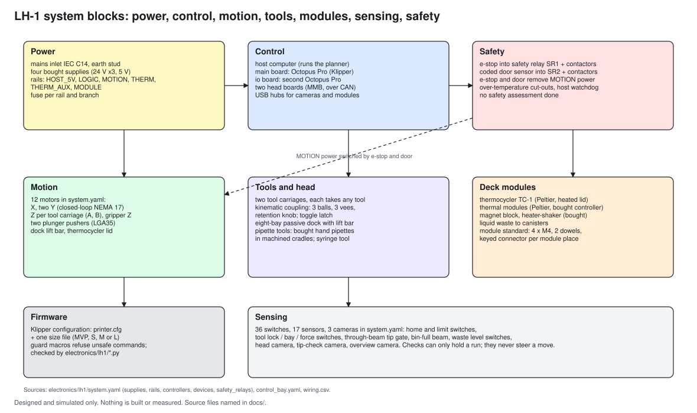
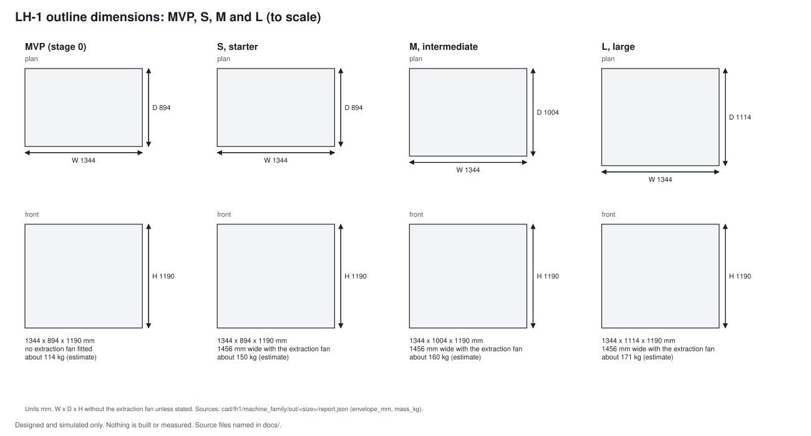
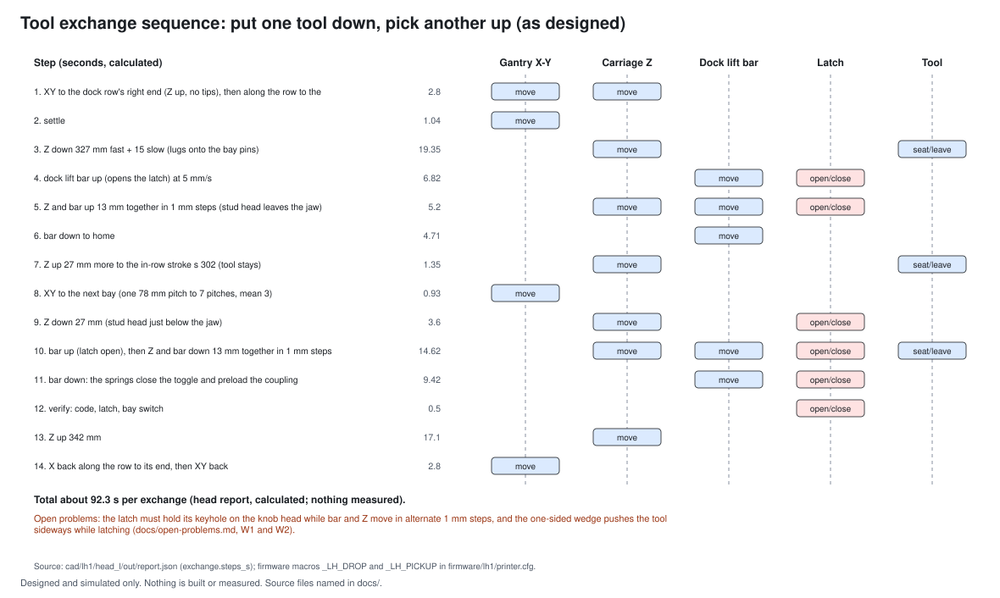
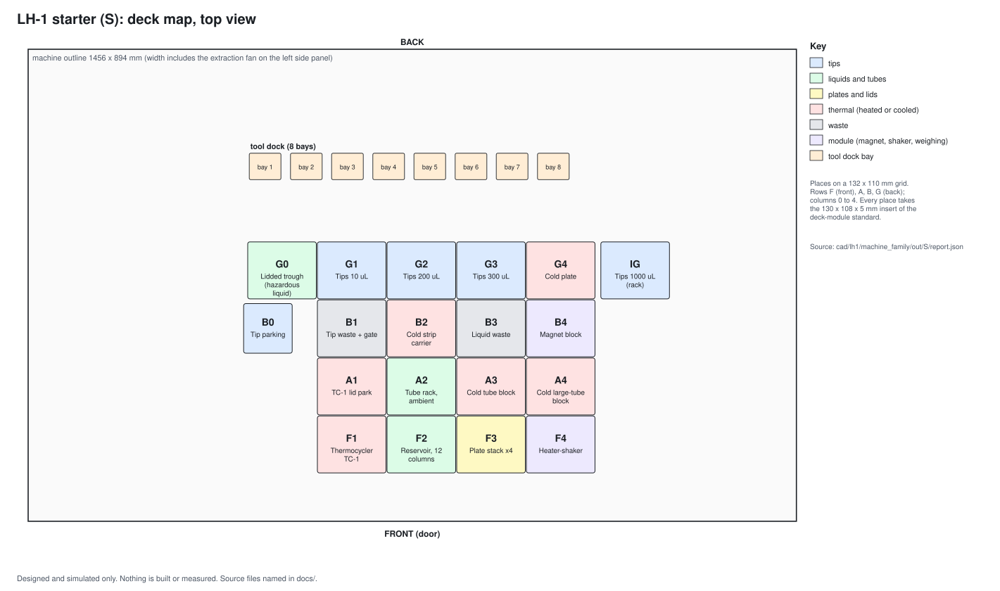

# Architecture

How the machine is put together, as designed. Each section names the files that hold the detail.

## Frame and gantry

Aluminium extrusions cut to length, bolted with bought corner brackets. The machine grows in depth only: width and height are fixed. A 100 x 50 x 5 mm aluminium tube X beam (TUBE-X_beam_100x50x5 in parts_S.csv) carries two MGN15 rails; two Y carriages run on MGN15 rails on the side beams. X and the two Y axes use closed-loop NEMA 17 motors and belts. Files: `cad/lh1/machine_family/scene.py`, `geometry.py`, `out/S/parts_S.csv`.

## Carriages and tools

The head on the X beam has two tool carriages (A and B) and a gripper axis. Each carriage has its own Z axis (NEMA 17, Tr8x2 lead screw) and a plunger pusher (a captive linear stepper, LGA35 class). A pipette tool is a bought hand pipette clamped in a machined cradle on a tool plate. The pusher presses the pipette's own plunger. Tips are picked up by Z force, ended by a force switch. Files: `cad/lh1/head_l/build.py`, `out/head_l_parts.csv`, `out/report.json`.

## Tool coupling and dock

Each tool plate carries three threaded tooling balls and a retention knob. They sit in three hardened vee seats under the carriage's coupling bracket. An over-centre toggle latch with a keyhole jaw pulls the knob up through a disc-spring cartridge. The tools are passive. An eight-bay dock behind the back row parks them; one lift bar under all bays opens the latch of whichever carriage is seated. The MVP replaces the latch with a manual clamp fork. **Two open problems (W1, W2) affect this latch.**

## Deck and the deck-module standard

The deck is laser-cut aluminium strips, one per row, on support bars. Places sit on a 132 x 110 mm grid. Every place takes a 130 x 108 x 5 mm insert held by four M4 screws and located by two 4 mm dowels. Module places have a keyed connector underneath. A module is anything that fits that insert: a plain insert, a cooled block, a magnet block, a shaker tray. Files: `cad/lh1/machine_family/deck_rules.py` (layout rules), `cad/lh1/deck_modules/out/IN-P_plain_insert_plate.*`.

## Modules

- Thermocycler TC-1: one zone, 96-well 0.2 mL plate, Peltier block driven by a bought controller, heated lid moved by the machine. Files: `cad/lh1/thermocycler/`.
- Thermal modules: Peltier blocks for cooled plates and tubes, driven by bought controllers.
- Magnet block, a bought heater-shaker (model not chosen), liquid waste with closed canisters in the drawer, tip parking comb.
- Tip supply: towers of nested tip wafers on a shelf above the back row; the gripper refills the deck frames.

## Sensing and cameras

Switches for homing, tool lock, bay occupancy, plunger force and drawer; a through-beam tip gate; a bin-full beam; waste level switches. Three cameras are designed in: a head camera reading markers on each place, a side camera at the tip gate, and an overview camera. Every check can only hold a run; none steers a move.

## Electrics and safety

Four bought supplies (PSU_MAIN 24 V, PSU_TC 24 V, PSU_AUX 24 V, PSU_5V 5 V) feed the rails HOST_5V, LOGIC, MOTION, THERM, THERM_AUX, MODULE, each fused. Control is a host computer, two BigTreeTech Octopus Pro boards running Klipper (main and io) and two MMB CAN boards on the head. The e-stop (safety relay SR1 and two contactors) and the coded door sensor (SR2 and two contactors) each remove MOTION power. Over-temperature cut-outs and a host-loss watchdog protect the heaters. Files: `electronics/lh1/system.yaml`, `wiring.csv`, `electrical_bom.csv`, `control_bay.yaml`, `cable_types.yaml`, `harness.svg`. No safety assessment has been done.

## Firmware

Klipper configuration. `printer.cfg` is the shared core; it includes one size file (`lh1_size_S.cfg`, `_M`, `_L`) and, for the MVP, a profile (`lh1_profile_MVP.cfg`) that marks absent devices so their commands refuse. Guard macros refuse unsafe commands (for example a descent over the thermocycler with its lid moving, or entering the dock with tips on). `electronics/lh1/fw_render_check.py` renders each guard macro against cases in `guard_cases.yaml`. Klipper itself has not loaded the configuration.

## What is not in this repository

The host software that plans runs and drives the firmware is not included. The firmware and CAD reference it in places (for example `planner_rules` in the CAD reports); those are notes for a host, not code here.
