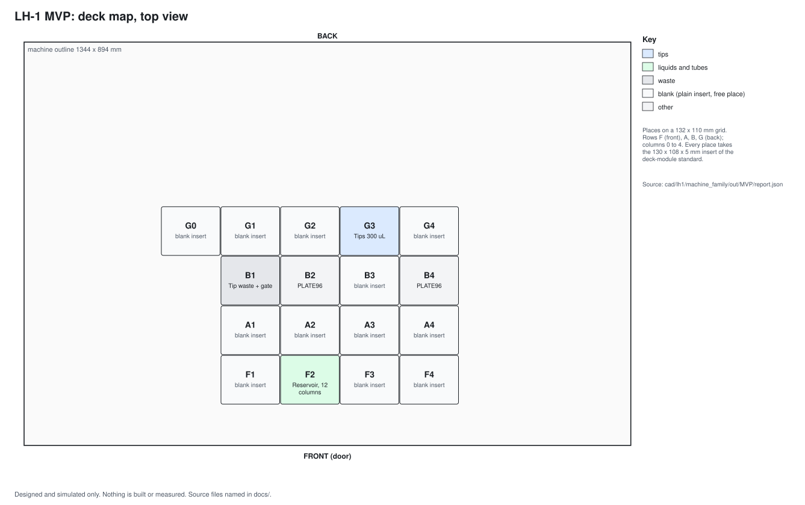
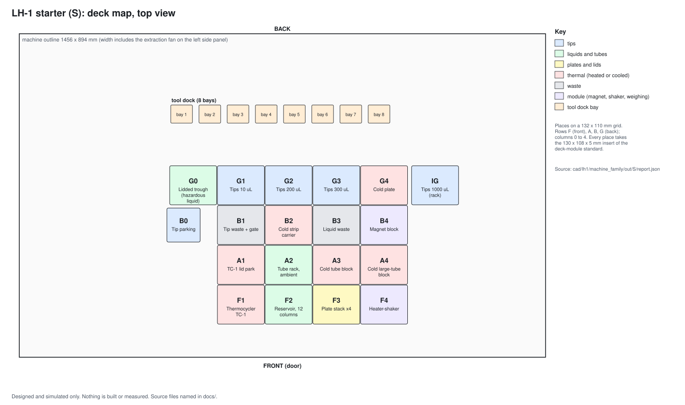
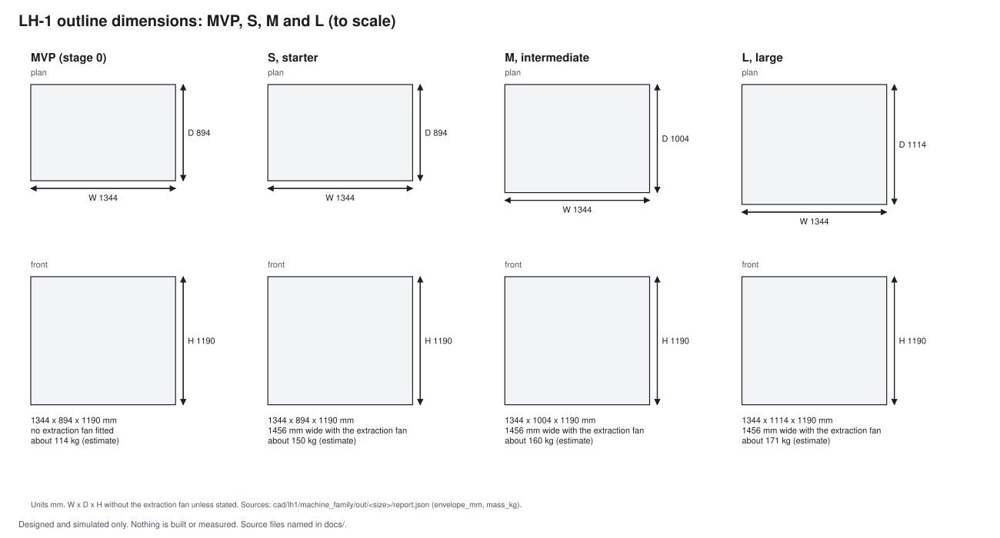
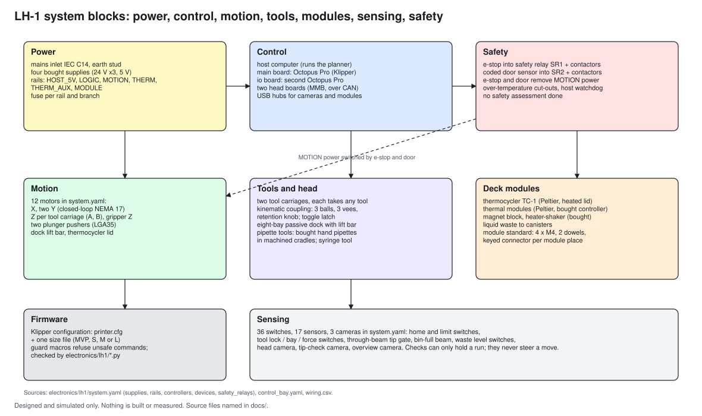
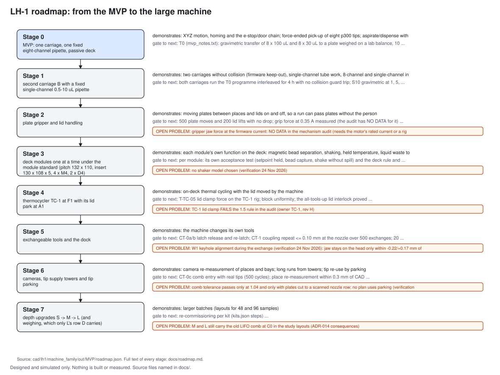
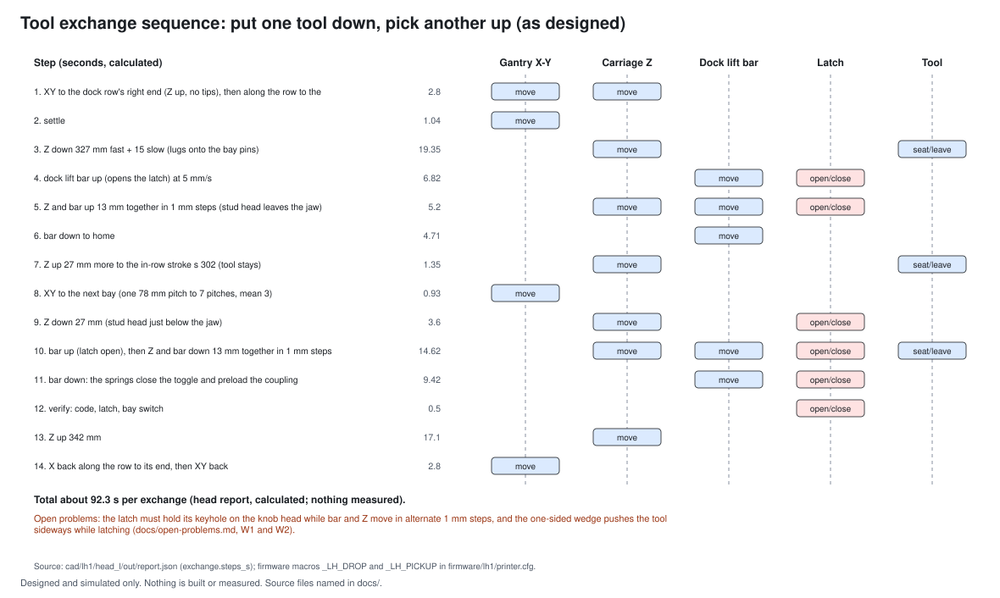

# Drawings

Made by `tools/make_drawings.py` from the CAD and electrical reports. SVG with a PNG copy beside each.

## MVP deck map

PNG: [img/deck_map_MVP.png](img/deck_map_MVP.png)

## Starter deck map

PNG: [img/deck_map_S.png](img/deck_map_S.png)

## Outline dimensions

PNG: [img/outline_sizes.png](img/outline_sizes.png)

## System blocks

PNG: [img/system_blocks.png](img/system_blocks.png)

## Roadmap

PNG: [img/roadmap.png](img/roadmap.png)

## Tool exchange sequence

PNG: [img/tool_exchange_sequence.png](img/tool_exchange_sequence.png)
