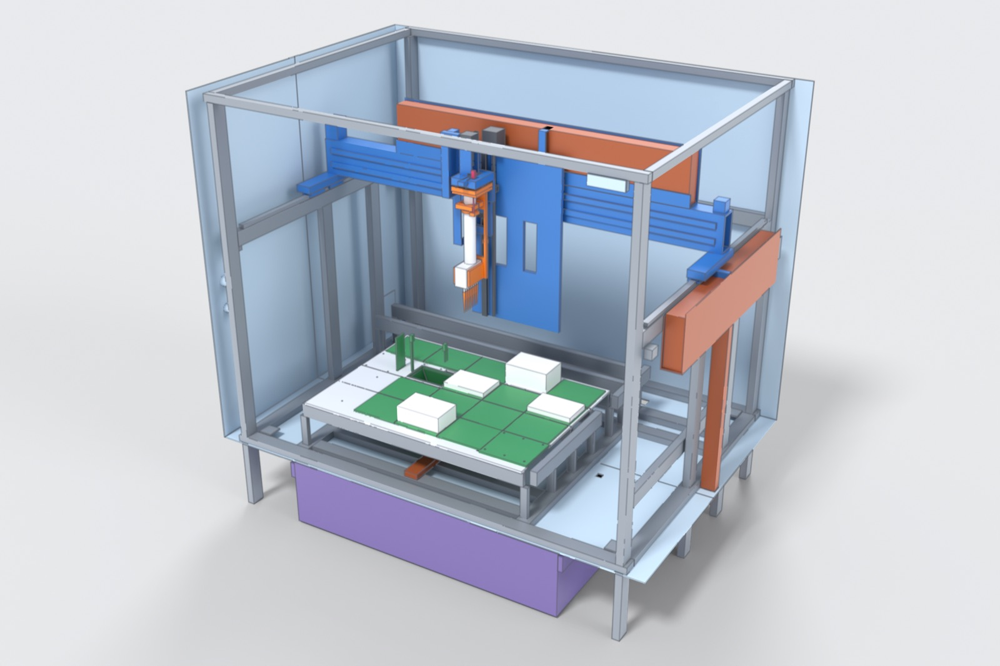
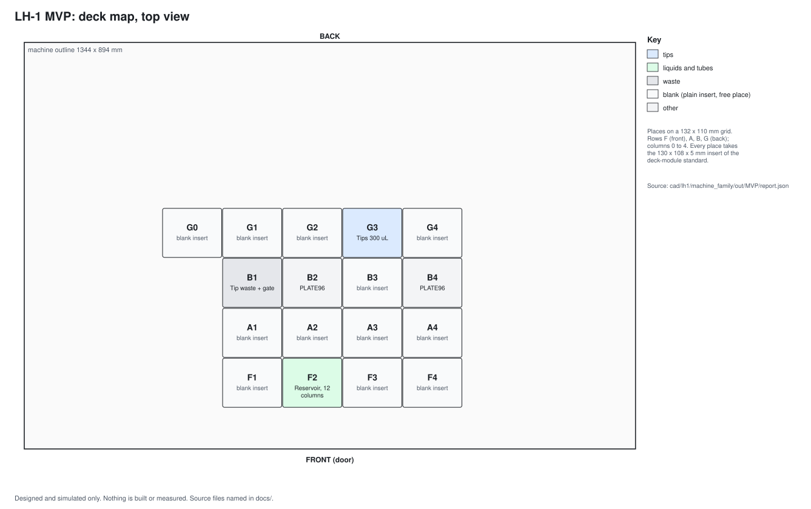
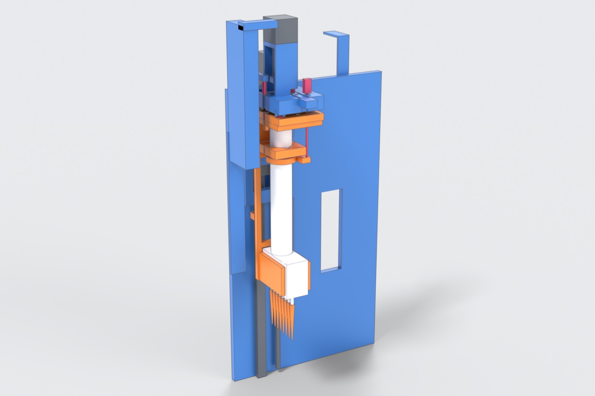

# The MVP build

> **Status: designed and simulated only.** Nothing has been built, bought or measured. Every figure here comes from the CAD, the electrical design or a calculation in this repository. Two open problems in the tool latch and coupling block the automatic tool exchange (see [open problems](open-problems.md)). There is no safety assessment.

## What it is

The starter's own frame, base, gantry, beam, deck strips, drawer, enclosure and control compartment at size S, generated by the same scene functions with the full S layout (so every one of those parts is the starter's part, unchanged), plus ONE tool carriage (carriage A: Z axis, plunger pusher, force and contact switches) holding ONE eight-channel 30-300 uL tool (M300) on the full design's tool plate and vee seats, held by a manual fork clamp MCL-1 in the latch channel in place of the LTG-1 latch.  The deck has passive places only.  Nothing of the dock, the latch, carriage B, the gripper, the modules, the cameras, tip parking, towers or extraction..

- Size: 1,344 x 894 x 1,190 mm (W x D x H). frame, panels, floor, feet, drawer: the starter's own (no extraction fan fitted: the starter's 1,456 mm width with the fan becomes 1,344 mm)
- Mass: about 114 kg (estimate).
- Parts: 146 lines, 143 made and 65 bought; MVP-only parts: IN-B_shaker_window_blank, MCL-K_clamp_fork (MVP clamp, replaces the LTG-1 latch until stage 5), MCL-S_set_screw_M5x12_dog_point_12.9.







## How the pipette tool is held

```text
The eight-channel 30-300 uL tool is the full design's tool: tool plate with three tooling balls and the retention knob, sitting in the
three hardened vee seats under the carriage's coupling bracket.  In place of the automatic latch, a manual clamp MCL-1 holds it:
- an 11 mm steel fork lies in the bracket's latch channel, its two prongs under the knob's head, feet under the prong tips on the
  channel floor, a tongue out through the bracket's front slot to a finger tab whose shoulder stops on the bracket's front face (locked);
- one M5 dog-point set screw through the tongue bears on the channel floor; tightened to 0.3 N m with the torque
  screwdriver (2.5 mm hex, from above) it levers the fork up and pulls the knob straight up with 550-916 N
  (the latch's band is 535-925 N);
- the pull is symmetric on the knob, so the tool is not pushed sideways (the latch's W2 fault does not arise).
Changing a tool is a MANUAL job at this stage: support the tool, loosen the screw two turns, pull the fork's tab forward to its stop
(28.5 mm; the prongs are then clear of the knob's head), lower the tool out.  Reverse to fit, re-torque, run the nozzle check.
```

## Deck

| Place | Station | Role |
|---|---|---|
| F1 | EMPTY | blanked: plain insert IN-P (the starter's standard insert) |
| F2 | RES2 | reservoir: 12-column (RES2), the starter's own reservoir place; coloured water / diluent in its columns |
| F3 | EMPTY | blanked: plain insert IN-P (the starter's standard insert) |
| F4 | EMPTY (MVP shaker-window blank IN-B) | blanked: IN-B shaker-window blank (MVP only; the shaker tray takes the window at stage 3) |
| A1 | EMPTY | blanked: plain insert IN-P (the starter's standard insert) |
| A2 | EMPTY | blanked: plain insert IN-P (the starter's standard insert) |
| A3 | EMPTY | blanked: plain insert IN-P (the starter's standard insert) |
| A4 | EMPTY | blanked: plain insert IN-P (the starter's standard insert) |
| B1 | TIPWASTE | tip waste: funnel, chute to the crate in the drawer, tip-check gate (the eject place) |
| B2 | PLATE96 | 96-well plate 1 (source / dilution plate), on a plain insert; the starter's cold strip place |
| B3 | EMPTY | blanked: plain insert IN-P (the starter's standard insert) |
| B4 | PLATE96 | 96-well plate 2 (destination plate), on a plain insert; the starter's magnet place |
| G0 | EMPTY | blanked: plain insert IN-P (the starter's standard insert) |
| G1 | EMPTY | blanked: plain insert IN-P (the starter's standard insert) |
| G2 | EMPTY | blanked: plain insert IN-P (the starter's standard insert) |
| G3 | P300 | p300 tips: the starter's P300 tip frame (recessed 15) with one 96-tip refill wafer loaded by hand |
| G4 | EMPTY | blanked: plain insert IN-P (the starter's standard insert) |


## Parts

| Sub-assembly | Made (qty) | Bought (qty) |
|---|---|---|
| deck | 4 | 1 |
| deck labware | 0 | 4 |
| drawer | 1 | 2 |
| enclosure | 18 | 4 |
| frame | 72 | 8 |
| gantry | 6 | 8 |
| head | 2 | 6 |
| head: Z axes | 0 | 3 |
| head: carriage A | 7 | 4 |
| head: carriage A clamp | 1 | 1 |
| head: coupling | 0 | 3 |
| head: pushers | 0 | 1 |
| services | 8 | 10 |
| station | 19 | 5 |
| tool M300 | 5 | 1 |
| tool plates | 0 | 8 |


Full list: [parts_MVP.csv](../cad/lh1/machine_family/out/MVP/parts_MVP.csv). Bought lines:

| Part | Qty | Sub-assembly | Note |
|---|---|---|---|
| BCB-corner_bracket_base | 4 | frame |  |
| MGN15_Y_rail_L | 1 | frame |  |
| MGN15_Y_rail_R | 1 | frame |  |
| Y_motor_NEMA17_closed_loop_L | 1 | frame |  |
| Y_motor_NEMA17_closed_loop_R | 1 | frame |  |
| CON-F_place_connector (keyed, panel mount, 6-pin) | 1 | deck |  |
| TGB-F_tip_gate_emitter_on_post | 1 | station |  |
| TGB-F_tip_gate_receiver_on_backlight | 1 | station |  |
| DRW-F_slides | 1 | drawer |  |
| TB-2_tip_crate_29L | 1 | drawer |  |
| TWB-F_bin_full_beam_emitter | 1 | station |  |
| TWB-F_bin_full_beam_receiver | 1 | station |  |
| TWB-F_beam_lead_route (4-core, clipped) | 1 | station |  |
| CTL-F_e_stop (22 mm panel hole) | 1 | enclosure |  |
| CTL-F_reset_button (22 mm panel hole) | 1 | enclosure |  |
| CTL-F_door_sensor_coded_non_contact | 1 | enclosure |  |
| CTL-F_door_sensor_actuator (on the door) | 1 | enclosure |  |
| YCH-F_y_chain_envelope (igus E2 medium class 38 x 18 R55) | 1 | services |  |
| UCR-F_under_deck_cable_rail_front | 1 | services |  |
| CBX-F_intake_fan_92mm_1 (with guard and filter) | 1 | services |  |
| CBX-F_intake_fan_92mm_2 (with guard and filter) | 1 | services |  |
| CBX-F_mains_inlet_IEC_C14_fused_switched | 1 | services |  |
| CBX-F_outlet_IEC_C13_TC-1 | 1 | services |  |
| CBX-F_outlet_IEC_C13_shaker | 1 | services |  |
| CBX-F_earth_stud_M6 | 1 | services |  |
| CBX-F_gland_G1_top_brush_grommet | 1 | services |  |
| CBX-F_gland_G2_right_M25 | 1 | services |  |
| MGN15_X_rail_z-20 | 1 | gantry |  |
| MGN15_X_rail_z+20 | 1 | gantry |  |
| MGN15H_Y_block_L-5 | 1 | gantry |  |
| MGN15H_Y_block_L-90 | 1 | gantry |  |
| MGN15H_Y_block_R-5 | 1 | gantry |  |
| MGN15H_Y_block_R-90 | 1 | gantry |  |
| X_motor_NEMA17_closed_loop | 1 | gantry |  |
| XCH-F_x_chain_envelope (igus E2 medium class 38 x 18 R55) | 1 | gantry |  |
| reservoir_12_col_44 | 1 | deck labware |  |
| plate_96_well | 2 | deck labware |  |
| tip_frame_p300_recessed15 | 1 | deck labware | placed by the person; the P300 frame takes one 96-tip p300 refill wafer by hand |
| MCL-S_set_screw_M5x12_dog_point_12.9 | 1 | head: carriage A clamp | the manual clamp in place of the latch (mvp.clamp_calcs); about £15 class; the latch channel it sits in is the starter b |
| MGN15_rail_479_Z | 1 | head: Z axes |  |
| MGN15H_block (4 X + 2 per Z axis) | 6 | head |  |
| NEMA17_48 Z motor | 1 | head: Z axes |  |
| T8x2_screw_473_and_nut | 1 | head: Z axes |  |
| Nanotec_LGA351S12-A-UIAP-038 pusher (LGA35) | 1 | head: pushers |  |
| tooling_ball_D10_threaded_shank | 3 | tool plates |  |
| vee_seat_hardened_90deg_16x14x8 | 3 | head: coupling |  |
| retention_knob_45deg_D16_M10 | 1 | tool plates |  |
| magnet_N52_D4x2 (tool-plate ID magnets, fitted as on every tool plate) | 4 | tool plates |  |
| sealed switch: cradle FORCE switch on the push-rod | 1 | head: carriage A |  |
| D2F switch: pusher CONTACT switch (pad on the slider) | 1 | head: carriage A |  |
| sealed switch: pusher RETRACTED switch | 1 | head: carriage A |  |
| FFC 20-way 1.0 mm (carriage A) | 1 | head: carriage A |  |
| eight-channel 30-300 uL pipette (bought, plunger driven by the pusher) | 1 | tool M300 |  |


## Tools needed

```text
Hex keys 1.5-6 mm, torque screwdriver 0.3-5 N m (the clamp and every M3/M4 into aluminium), feeler gauges, square, straightedge, dial
indicator on a magnetic base, calipers, spirit level, crimp tools and wire strippers, multimeter, a lab balance (0.1 mg class) and a plate
reader for the demonstration (bench instruments, not part of the machine).
```


## What is bought

```text
Extrusions cut to length, rails and blocks, motors and belts, the LGA35 pusher, Tr8x2 screw, tooling balls, vee seats, retention knob,
switches, FFC, cable chains, drawer slides, crate, the bought eight-channel pipette, safety relays, contactors, supplies, the controller,
door sensor, e-stop: the bought lines of parts_MVP.csv.  Made: deck strips and panels (laser-cut sheet), inserts, brackets, carriage plate,
cradle, tool plate, the MCL-1 fork.
```


## Assembly order

```text
 1 Frame: base members, corner brackets, feet, uprights, side beams, back top member, roof frame; deck bars and posts; shelf and dock rails
   (they are frame members of the starter and stay bare until stages 2 and 5).  Square and level (feelers, square, spirit level).
 2 Y rails on the side beams (rail jig and straightedge), Y blocks, Y carriages; X beam with its two X rails; X and Y motors, belts, tension.
 3 Chains: X chain tray and chain on the beam, Y chain tray, chain and vertical duct; connector plane and under-deck cable rail.
 4 Control compartment under the base: plates, safety relays SR1/SR2, contactors, supplies, fans; mains inlet; earth stud.
 5 Head: carriage plate on the X blocks; carriage A Z rail, blocks, screw and motor; coupling bracket with the three vee seats; pusher
   bracket and LGA35 pusher, rod, collar and RETRACTED switch; force switch; FFC loop; eject finger at x -26; MCL-1 fork in the channel.
 6 Tool: cradle, straps, cheeks and pipette on the tool plate; balls and knob screwed to their shoulders; fit it under the bracket; clamp.
 7 Deck: four deck strips on the bars (dowels, screws); tip waste funnel at B1 with the chute to the crate, tip-check gate (emitter and
   receiver on the VC-2 bracket and backlight, camera not fitted), its B1 connector; P300 tip frame at G3; plain inserts at every other
   place, the shaker-window blank at F4; reservoir on F2, plates on B2 and B4.
 8 Drawer with slides and the 29 L tip crate; bin-full beam on the chute.
 9 Enclosure: floor sheets, side, back and roof sheets, roof blank, hand-off blank plates, door with the door sensor; e-stop and reset.
10 Wiring of the MVP subset (motion, carriage A, gate, door, e-stop) and the firmware with carriage B, gripper, dock and latch disabled.
```


## Wiring

### What is in it

```text
Fitted devices: 59 of the starter's 156. By kind: breakout 5, button 1, computer 1, contactor 4, controller 3, earth 12, estop 1, fan 1, fuses 1, gate_relay 1, inlet 1, light 1, motor 5, safety_relay 2, safety_sensor 1, sensor 4, supply 2, switch 9, terminals 4
Boards: main Octopus Pro v1.1 (X, Y, Y1 step/dir to the closed-loop motors; CAN bridge; e-stop and door monitors; tip gate),
  io Octopus Pro (tip drawer, bin-full beam, gate backlight, compartment fan rotation detect), ONE MMB CAN V2.0 (MMB_A: Z_A, pusher A,
  Z home, pusher retracted, contact and force switches; its 120 ohm CAN jumper ON as the bus end; EZ3 (gripper Z) left empty),
  Raspberry Pi host (USB to both Octopus boards; no USB hubs).
Supplies: PSU_MAIN (24 V 25 A, LOGIC + MOTION) and PSU_5V (host). PSU_TC and PSU_AUX are NOT fitted: their mains loop is joined by covered terminal blocks in their positions.
Drivers: three step/dir breakouts to the X, Y, Y1 closed-loop motors; two EZ5160 Pro on MMB_A (Z_A 0.9 A, pusher 0.7 A).
Switches and sensors: X, Y, Y-right end stops; three servo-alarm inputs; Z_A home (NC); Z_UP_A in the all-tools-up chain (K_CH on rail E reads it);
  pusher retracted, contact and force switches (NC); tip-gate beam pair with its supply switch TG_SW and the VC-2 backlight; drawer switch; bin-full beam; one fan RD.
Safety: e-stop SR1 + KM1/KM2 (monitored manual reset) and the coded door sensor SR2 + KM3/KM4, both in series in MOTION, exactly as the starter.
Fuses fitted: F1, F2, F6, F7, F21, F22, F25, F26, F27 (starter numbers; every other position empty).
```

### Counts

```text
Cables: 111 of the starter's 276. By type: DEVICE_LEAD 5, FFC_20_1MM 4, MAINS_2X10 4, MC2_025 14, MC2_10 2, MC3_025 1, MC4_025 2, MC6_025_SH 2, MC7_05_SH 1, MOTOR_LEAD 1, PE_GY_15 3, PE_GY_25 10, PLUG_IN 5, SC_05 28, SC_10 3, SC_15 4, SC_25 5, SC_40 2, SC_HF_025 8, SC_HF_075 2, SC_HF_15 1, USB2_AC 2, USBC_PWR 1, XT30_LEAD 1
By function: 0V 3, 24V 36, 5V 1, CAN 1, ENDSTOP 7, FE 1, MAINS 4, MOTOR 2, PE 13, SAFETY 21, SIGNAL 14, STEP/DIR 6, USB 2
Joints (harnessgen classes, ADR-003 tool-made vs tool-free):
  tool: ring lug / receptacle crimp: 28
  tool: bootlace ferrule: 208
  tool-free: pre-made / moulded / plug-in: 136
  tool: solder + heat-shrink: 9
  tool-free: lever splice: 35
  tool-free: ZIF / flat-flex: 20
  tool-made joints, total: 245
Bill of materials: 104 lines (out/mvp/electrical_bom_MVP.csv), including 8 bridge parts.
```

### Power budget

```text
  rail LOGIC: 1.69 A of 8.0 A (F1), 21 %
  rail MOTION: 7.22 A of 16.0 A (F2), 45 %
  rail HOST_5V: 5.0 A of 10.0 A (PSU5_LIMIT), 50 %
  branch F6: 0.7 A of 2.0 A, 35 %
  branch F7: 0.24 A of 2.0 A, 12 %
  branch F21: 5.5 A of 10.0 A, 55 %
  branch F22: 1.73 A of 6.3 A, 27 %
  supply PSU_MAIN: 8.91 A of 25.0 A, 36 % (rule <= 77 %: True)
  supply PSU_5V: 5.0 A of 10.0 A, 50 % (rule <= 77 %: True)
  mains: about 1.17 A at 230 V on the T10A H inlet fuse
  compartment heat 57.5 W: needs 10.1 CFM for a 10 K rise; ONE fan gives 24.0 CFM (4.2 K, 2.38 x): one fan is enough;
  the second fan comes with PSU_AUX (deck modules). A stopped fan is reported (io PF0); with no forced air the box is about 9 K above room air (ESTIMATE).
```

### Order of wiring

```text
  1 plates, DIN rails, PE stud; every PE bond (W-E-*) and continuity measured before anything is powered;
  2 COMPETENT PERSON: inlet, PSU_MAIN, bridge blocks, PSU_5V (W-M-*), insulation test; supplies powered with no load, PSU_MAIN set to 24.0 V, PSU_5V to 5.1-5.2 V;
  3 rail A/B: fuse terminals (fuses OUT), XT distribution, SR1, SR2, KM1-KM4, the four feedback-loop bridge terminals, e-stop, reset, door sensor (W-S-*);
  4 LOGIC (F1, F6, F7) to both Octopus boards (all driver-voltage jumpers on MOTOR_POWER, all DIAG jumpers removed), host USB;
  5 gantry: breakouts, X/Y/Y1 motors and alarms, end stops (W-G-*, W-F-*); MOTION feeds W-P-06..10, F21, F25-F27;
  6 head: chains: head supply W-P-28 and CAN W-C-07 to the lever-splice block, XT30 lead W-C-09 to MMB_A (120 ohm ON at MMB_A in the MVP), Z_A, 1.0 mm FFC to carriage A,
    all-tools-up chain with its two lever-splice bridges, K_CH;
  7 deck and services: tip gate, TG_SW and the gate backlight, drawer, bin beam, compartment fan 1.
```

### Power-on checks

```text
  a supplies alone (fuses out): voltages; b fuses in one rail at a time, boards enumerate (USB, can0, canbus_query shows MMB_B);
  c with MOTION fuse F2 OUT: e-stop pressed -> SR1 will not reset; released -> reset lamp, KM1/KM2 pull in; a bridge terminal opened -> reset refused;
    door open -> KM3/KM4 drop; d every NC input broken-wire test (unplug: reads triggered/blocked); tools-up chain opens when Z_A is lowered;
  e F2 in: motors enable, servo alarms read healthy; G28 (gripper Z declared at 0, Z_A up, pusher A homed at 0.50 A and its contact found, X then Y);
  f tip gate commissioning (gate stays NOT armed until the dry run measures the beam with real tips); g check.py and fw_render_check.py green.
```

### Competent person, even at MVP stage

```text
  - mains: IEC inlet with switch and T10A H fuses, W-M-01 to PSU_MAIN, the loop W-M-02/03/04 through the two covered terminal-block bridges to PSU_5V, cord grips, mains in its own duct;
  - protective earth: PE stud, every bond (frame, plates, compartment box, deck, panels, floor sheets, CBP2, gantry functional bond), continuity < 0.1 ohm, insulation resistance, PAT regime;
  - SR1/SR2 with KM1-KM4: settings, feedback loops including the four bridge terminals, e-stop and door proof tests, stop category / PL claim;
  - the guard (full enclosure, coded door sensor, as the starter); SELV/PELV decision; conductor protection table for the fitted fuses.
```

Files: [wiring_MVP.csv](../electronics/lh1/out/mvp/wiring_MVP.csv), [electrical_bom_MVP.csv](../electronics/lh1/out/mvp/electrical_bom_MVP.csv), [budgets_MVP.json](../electronics/lh1/out/mvp/budgets_MVP.json), [mvp_electrical_notes.txt](../electronics/lh1/out/mvp/mvp_electrical_notes.txt).


## Firmware profile

```text
Klipper loads firmware/lh1/printer_MVP.cfg (GENERATED from printer.cfg without the absent devices' sections) which includes lh1_size_S.cfg and
lh1_profile_MVP.cfg. Every command of an absent device refuses with DEVICE_ABSENT (CARRIAGE_ABSENT for carriage B). Tips: the force-ended pick-up
observes 'on'; after an eject the tips are UNKNOWN until the tip gate (fitted, as in the full design) sees bare nozzles; while the gate is not yet
commissioned a person confirms (LH_TIPS_CONFIRM), exactly as the starter. Printer Z (the gripper Z on head_a EZ3) has no motor: homing_override
declares it at 0 and every G0/G1 Z refuses. Dispensing over B3 refuses DEVICE_ABSENT (no liquid waste); module, shaker, TC-1 and tip-parking places refuse descents.
```
The profile is [lh1_profile_MVP.cfg](../firmware/lh1/lh1_profile_MVP.cfg); the generated top file is [printer_MVP.cfg](../firmware/lh1/printer_MVP.cfg). Klipper has not loaded either.


## Commissioning checks and the demonstration run

```text
 C1 frame square and level; rails parallel within 0.05 mm over their length (dial indicator)
 C2 e-stop and door: each removes motion power (motors free) in every axis state; reset needed after the e-stop
 C3 homing X, Y, Z and the pusher onto its RETRACTED switch; soft limits at the starter's travel
 C4 tip-check gate reads eight tips / no tips; force switch trips at the pick-up force on a spring scale
 C5 tool clamp: 20 re-clamps, nozzle 1 position by dial indicator repeats within 0.10 mm; screw torque 0.3 N m
 C6 deck: the head camera is not fitted, so each working place is taught by jogging the nozzle row to a jig plate and compared with CAD
 C7 tip pick-up at G3 and eject at B1, 50 cycles, no retained tip
 Then the demonstration T0: pick up eight tips; transfer coloured water from the reservoir to plate 1; plate-to-plate transfer to plate 2;
 a serial dilution across plate 1 (column to column, mixing); eject; repeat with fresh tips.  Measure by weighing the plate on a lab
 balance before and after (gravimetric, per column) or by reading absorbance of the dye dilution in a plate reader.
```

**Test that gates stage 1:** T0 (mvp_notes.txt): gravimetric transfer of 8 x 100 uL and 8 x 30 uL to a plate weighed on a lab balance, 10 repeats: per-channel mean within 2 % and CV within 1.5 % at 100 uL (ISO 8655 class targets, ASSUMED for this machine); a 1:2 serial dilution of dye over 11 columns read by absorbance, slope within 5 % of the ideal; 200 pick-up/eject cycles with no missed or retained tip; 20 re-clamps of the tool with nozzle position repeat <= 0.10 mm


## Left out, and why

```text
- Tool dock, dock lift bar, latch: the latest independent check found two unsolved faults in the latch and dock lift (W1 keyhole alignment,
  W2 one-sided wedge side load); the MVP must not depend on them.  They come in stage 5 once solved and rig-tested.
- Second carriage, gripper axis: not needed to show pipetting; stages 1 and 2.
- Thermocycler, shaker, magnet, cold modules, liquid waste: modules, added one at a time under the module standard (stages 3 and 4).
- Cameras (head camera, VC-2 camera), weighing, tip-parking comb, tip towers and shelves: stage 6 (weighing arrives only with L's row D).
- Ethanol extraction fan: no ethanol in the MVP; the grille stays in the panel.
- The guarding is NOT left out: the starter's enclosure, door sensor and e-stop are fitted (report.json guarding).
```


## Not verified

- everything: nothing is built or measured
- MCL-1 preload band (nut factor K 0.15-0.25 ASSUMED), its residual side load and the re-clamp repeatability (commissioning C5)
- tip pick-up force 120 N and eject 90 N (ASSUMED until CT-9); the LGA35 thrust curve at 0.7 A (sourcing INFERENCE)
- Z thrust figures are the electrical design's calculation (system.yaml), not measured
- plate well floor 1 mm above the skirt (PLATE96, ASSUMED class); reservoir and tip-frame heights from the deck_k classes
- mass: modelled volumes x densities plus ASSUMED electrics 12 kg and boards 0.5 kg
- bought-part envelopes (classes, not part numbers), as in the starter
- accuracy targets of the demonstration (ISO 8655 class figures ASSUMED for this machine)

## Not done in the CAD

- firmware configuration for one carriage (printer.cfg is the full design's; carriage B, gripper, dock and latch sections must be disabled) - outside cad/
- wiring list for the MVP subset - outside cad/
- planner/liquid classes for the demonstration
