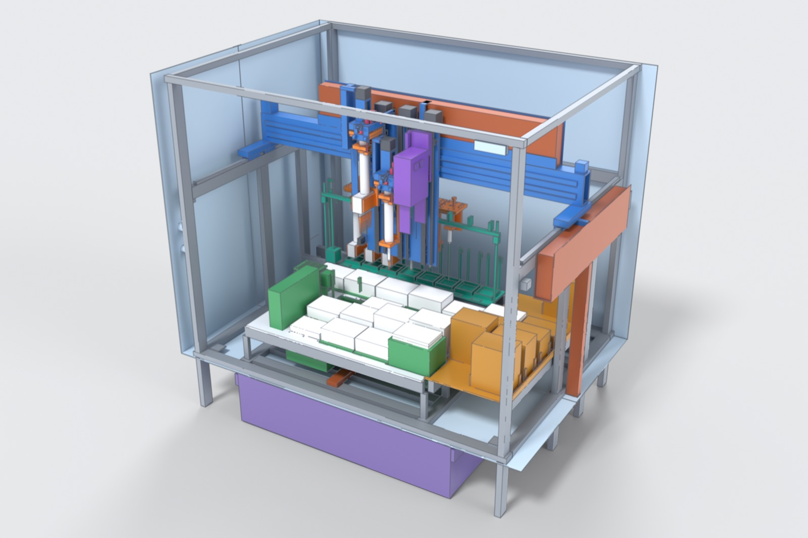
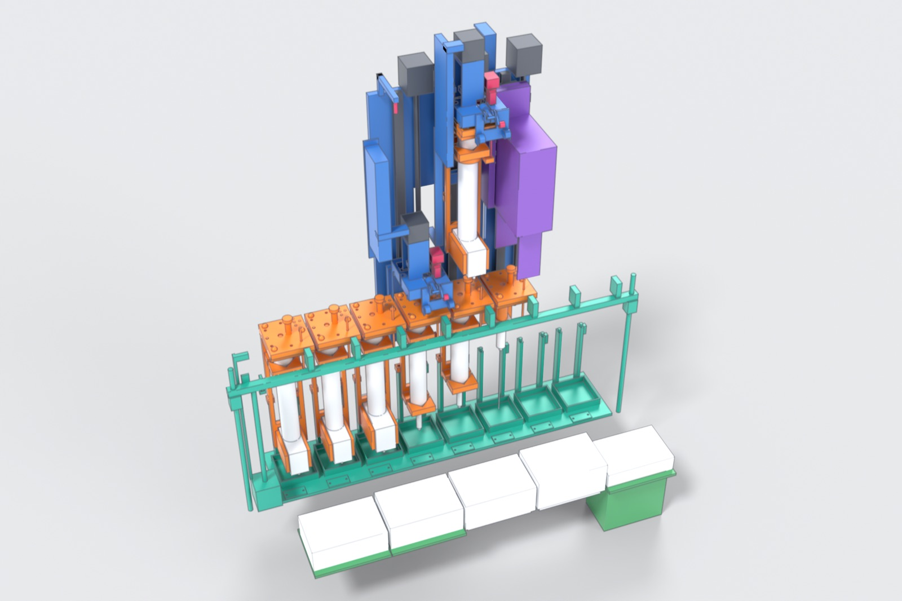
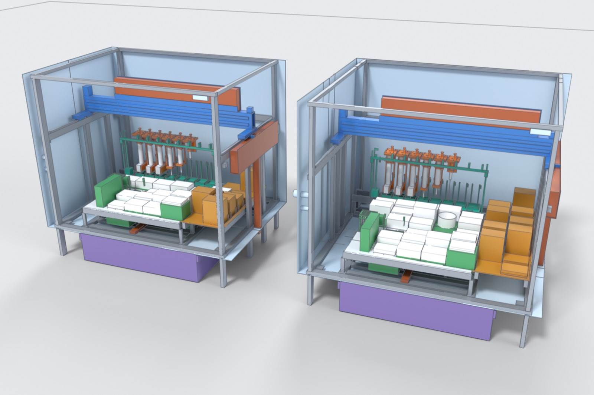
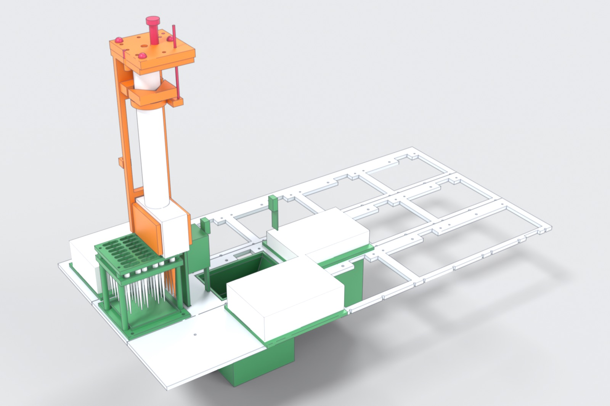
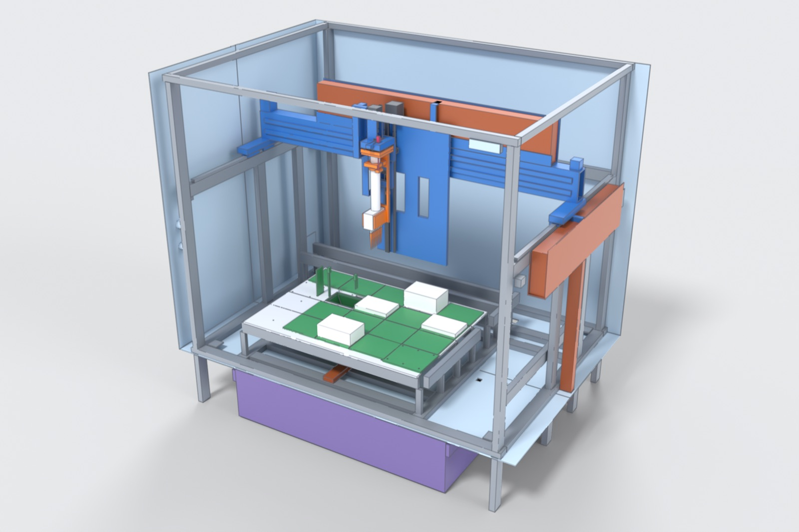
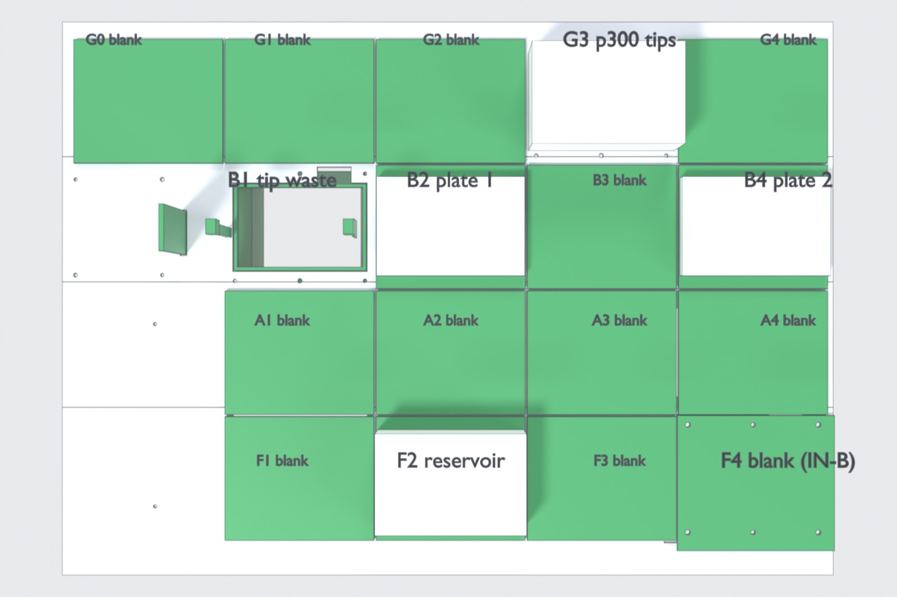
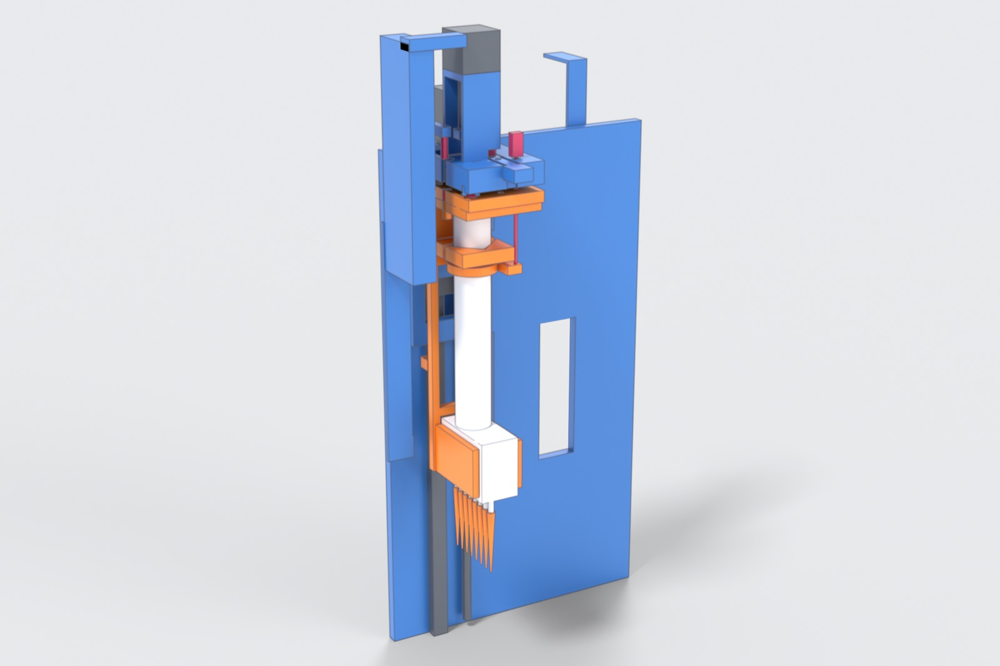
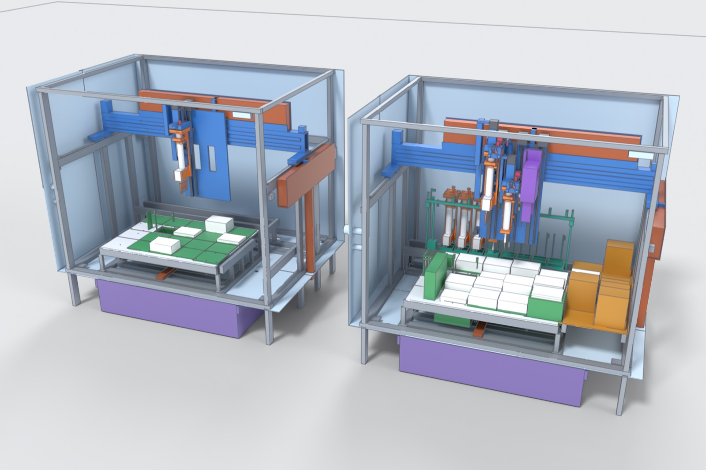

# Pictures

Rendered from the CAD model with Blender (`cad/lh1/visualise/`). Nothing in them is built.

*Starter S (ADR-011): 1,344 x 897 x 1,190 mm (1,456 with the extraction fan on the left side panel), 4 rows, 18 stations (tip parking TPK-S at B0); exchange head on the gantry with the X cable chain on the beam, Y chain in its tray on the right, eight-bay dock behind row G, shelf with towers and hand-off H1, control compartment under the base behind the drawer; door, roof and right panel hidden*

*2_S_top_view_labelled: left out until it is re-rendered with the current station names; see the deck map in [drawings](drawings.md).*

*Starter S dock: eight bays at 78 mm pitch behind row G, tools parked on their cradle lugs (bays 1-6), the dock lift bar with a pad under each bay's latch roller (actuator at the left end), the camera marker (tag + two holes) in front of each drip tray; carriage A lowering onto bay 4, carriage B holding the 5-50 uL tool clear above the neighbours; FFC loops beside the carriage plate*

*Same scale: starter S (left, 894 mm deep, 4 rows) and large L (right, 1,114 mm deep, 6 rows): same width, height, gantry, head, dock, drawer and control compartment; L = S + rows C and D inserted in front of row G*

*Starter S tip parking TPK-S, random access: three groups (spot, entry, spot) = 6 eight-channel p300 sets (48 tips, shown at full load) in 1 mm detent pockets over a walled drip tray; carriage B's 30-300 tool at the deepest spot, 5 mm from the VC-2 camera of the tip waste B1; designed, checked in the model, not built*

*LH-1 MVP (stage 0 of the starter): 1344 x 894 x 1190 mm, about 114 kg (estimate); the starter's own frame, gantry, deck strips, drawer, enclosure and control compartment; ONE carriage with the eight-channel 30-300 uL tool held by the manual clamp MCL-1 over plate 1 (B2); passive deck: p300 tips G3, reservoir F2, plates B2 and B4, tip waste B1, every other place blanked; no dock, no shelf; door, roof and right panel hidden.  Designed and checked in the model, not built*

*MVP deck from above: passive places only on the starter's grid (rows F, A, B, G); p300 tip frame G3 (refill wafer loaded by hand), 12-column reservoir F2, two 96-well plates B2 and B4 on plain inserts, tip waste B1 with its tip-check gate (VC-2 camera not fitted); every other window closed by a plain insert, the shaker window F4 by the MVP-only blank IN-B*

*MVP carriage A with the eight-channel 30-300 uL tool (tips on): Z axis, LGA35 plunger pusher with its RETRACTED switch, cradle force switch, the full design's tool plate on three vee seats, held by the manual fork clamp MCL-1 in the latch channel (finger tab in front of the bracket, one M5 set screw at 0.30 N m: preload 550-916 N, CALCULATED); changing the tool is a manual job*

*Same scale: the MVP (left) and the full starter S (right).  Same frame, gantry, deck strips, drawer, enclosure and control compartment; the starter adds carriage B, the gripper, the latch, the eight-bay dock with tools, the shelf with towers, the deck modules, TC-1, tip parking, cameras and the extraction fan*
