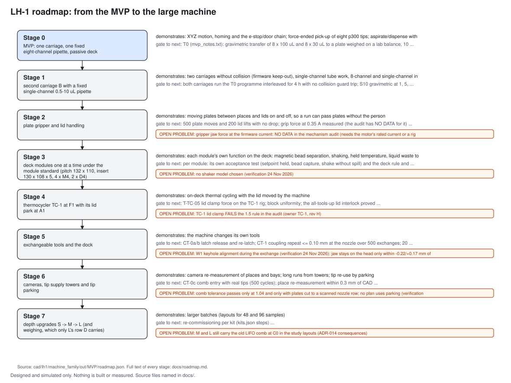

# Roadmap

Each stage adds hardware to the one before. Nothing is thrown away: the MVP already uses the starter's frame, gantry, deck, drawer, enclosure and control compartment. A stage starts only when the test of the stage before has passed.

stages 1-4 and 6 are independent of the latch; stage 5 is held until W1 and W2 are solved on paper and rig-tested.

## Stage 0: MVP: one carriage, one fixed eight-channel pipette, passive deck

**Demonstrates:** XYZ motion, homing and the e-stop/door chain; force-ended pick-up of eight p300 tips; aspirate/dispense with the pusher; reservoir-to-plate and plate-to-plate transfers; a serial dilution across a plate; eject at the tip waste; repeated cycles

**Test before the next stage:** T0 (mvp_notes.txt): gravimetric transfer of 8 x 100 uL and 8 x 30 uL to a plate weighed on a lab balance, 10 repeats: per-channel mean within 2 % and CV within 1.5 % at 100 uL (ISO 8655 class targets, ASSUMED for this machine); a 1:2 serial dilution of dye over 11 columns read by absorbance, slope within 5 % of the ideal; 200 pick-up/eject cycles with no missed or retained tip; 20 re-clamps of the tool with nozzle position repeat <= 0.10 mm

Build page: [build/stage-0.md](build/stage-0.md)

## Stage 1: second carriage B with a fixed single-channel 0.5-10 uL pipette

**Demonstrates:** two carriages without collision (firmware keep-out), single-channel tube work, 8-channel and single-channel in one run

**Test before the next stage:** both carriages run the T0 programme interleaved for 4 h with no collision guard trip; S10 gravimetric at 1, 5, 10 uL

Build page: [build/stage-1.md](build/stage-1.md)

## Stage 2: plate gripper and lid handling

**Demonstrates:** moving plates between places and lids on and off, so a run can pass plates without the person

**Test before the next stage:** 500 plate moves and 200 lid lifts with no drop; grip force at 0.35 A measured (the audit has NO DATA for it)

**Open before it can proceed:**
- gripper jaw force at the firmware current: NO DATA in the mechanism audit (needs the motor's rated current or a rig measurement)

Build page: [build/stage-2.md](build/stage-2.md)

## Stage 3: deck modules one at a time under the module standard (pitch 132 x 110, insert 130 x 108 x 5, 4 x M4, 2 x D4)

**Demonstrates:** each module's own function on the deck: magnetic bead separation, shaking, held temperature, liquid waste to canisters

**Test before the next stage:** per module: its own acceptance test (setpoint held, bead capture, shake without spill) and the deck rule and interference checks re-run with that module in the layout

**Open before it can proceed:**
- no shaker model chosen (verification 24 Nov 2026)

Build page: [build/stage-3.md](build/stage-3.md)

## Stage 4: thermocycler TC-1 at F1 with its lid park at A1

**Demonstrates:** on-deck thermal cycling with the lid moved by the machine

**Test before the next stage:** T-TC-05 lid clamp force on the TC-1 rig; block uniformity; the all-tools-up lid interlock proved

**Open before it can proceed:**
- TC-1 lid clamp FAILS the 1.5 rule in the audit (owner TC-1, rev H)

Build page: [build/stage-4.md](build/stage-4.md)

## Stage 5: exchangeable tools and the dock

**Demonstrates:** the machine changes its own tools

**Test before the next stage:** CT-0a/b latch release and re-latch; CT-1 coupling repeat <= 0.10 mm at the nozzle over 500 exchanges; 20 exchanges per carriage per bay

**Open before it can proceed:**
- W1 keyhole alignment during the exchange (verification 24 Nov 2026): jaw stays on the head only within -0.22/+0.17 mm of bar height
- W2 one-sided 45 deg wedge preload pushes the tool sideways about as hard as the preload; no calculation covers it
- major: re-latch margin 1.5 only at nominal (1.39-1.49 in its band, 1.04 in CT-0b); constant-force springs at about 4 GPa
- the redesign must be rig-tested before any machine purchase (ADR-014)

Build page: [build/stage-5.md](build/stage-5.md)

## Stage 6: cameras, tip supply towers and tip parking

**Demonstrates:** camera re-measurement of places and bays; long runs from towers; tip re-use by parking

**Test before the next stage:** CT-0c comb entry with real tips (500 cycles); place re-measurement within 0.3 mm of CAD

**Open before it can proceed:**
- comb tolerance passes only at 1.04 and only with plates cut to a scanned nozzle row; no plan uses parking (verification 24 Nov 2026)

Build page: [build/stage-6.md](build/stage-6.md)

## Stage 7: depth upgrades S -> M -> L (and weighing, which only L's row D carries)

**Demonstrates:** larger batches (layouts for 48 and 96 samples)

**Test before the next stage:** re-commissioning per kit (kits.json steps)

**Open before it can proceed:**
- M and L still carry the old LIFO comb at C0 in the study layouts (ADR-014 consequences)

Build page: [build/stage-7.md](build/stage-7.md)
